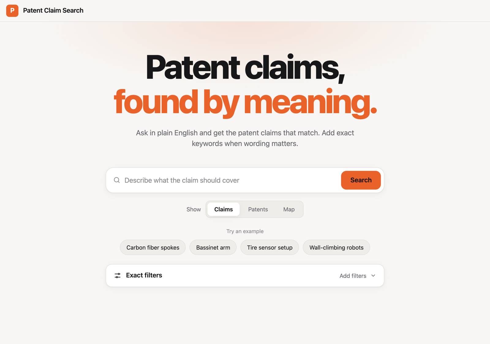
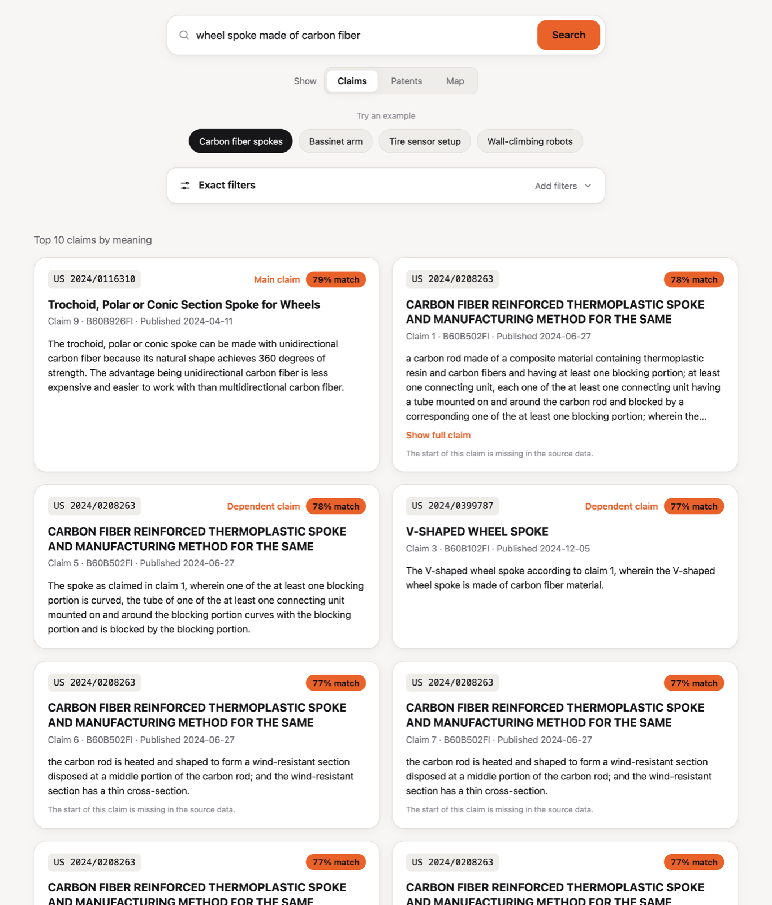
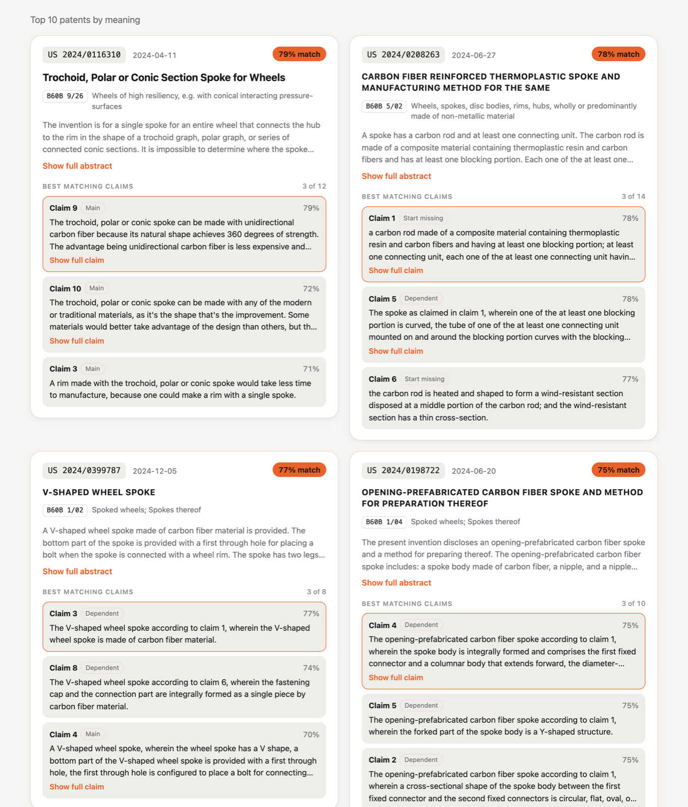
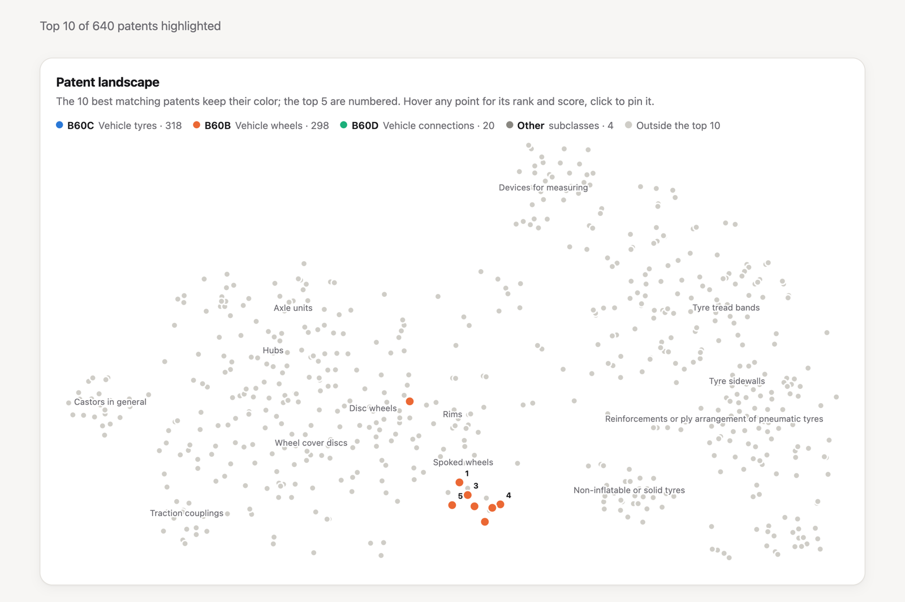
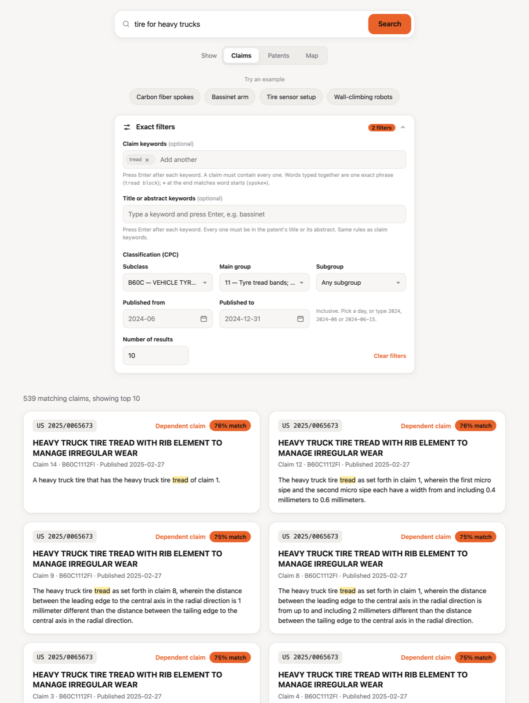

# Patent Claim Search

Type a plain-English question, optionally add exact keywords and filters, and get back the patent **claims** that best match.

Videos:
* Part 1, working demo of the search engine: [watch on Google Drive](https://drive.google.com/file/d/1lPqW-x4CqjXjFeB1wDF0l8hVAfHeWaeF/view?usp=sharing)
* Parts 2 and 3, walkthrough: [watch on Google Drive](https://drive.google.com/file/d/19eDAZgtrVnoizNueqhHJL2NEEgb2biJV/view?usp=sharing)

* Part 1: claim search with hybrid filters (this README)
* Part 2: system design at 10M patents and a FAISS proof of concept ([`part2/`](part2/))
* Part 3: evaluation and training ([`part3/README.md`](part3/README.md))

## Problem statement

An examiner checking whether an idea is new needs the specific **claims** that cover it, not just related patents. So the problem I chose:

> Given a plain-English description of an invention, return the matching claims ranked by meaning, let the examiner narrow them with exact filters (keywords, classification, dates), and measure on graded questions whether the model can be trained to rank them better.

## How to run

Needs Python 3.11+. The patent data is already in the repo (`data 2/patent_data_small/`). The first run downloads the nomic model from Hugging Face.

```bash
python3.11 -m venv .venv && source .venv/bin/activate
pip install -e ".[dev,train]"
```

### Part 1

```bash
python -m patent_search build    # once, ~10 min: builds the search index in data/index/
python -m patent_search serve    # then open http://localhost:8000/
```

`build` reads the patent files and embeds every claim. It prints 640 patents, 10,411 claims indexed, 119 without a description and 3,200 claims with missing openings. The index is not in the repo because it is generated.

`serve` starts the web server for the page; stop it with `Ctrl+C` (use `--port 8001` if 8000 is taken). On the page, type a question or click an example. **Show** switches between Claims, Patents and Map, and **Exact filters** adds keywords (press Enter after each), classification and dates. The first search with a question takes about 8 seconds while the model loads.

Optional:

```bash
python -m patent_search search -k sipe -c "B60C 11" --from 2024-06 --by patent   # a filtered search from the command line
python -m patent_search.benchmark                                                # reproduces the timing table below
```

**Screenshots**

The search page.



Search by meaning ("wheel spoke made of carbon fiber"): claims ranked with a match score and labelled main or dependent.



The same question grouped by patent, with each patent's best matching claims.



Map view: every patent placed by meaning, with the top matches lit and the top 5 numbered.



Hybrid search ("tire for heavy trucks"): two exact filters, the claim keyword `tread` and classification B60C 11, narrow it to 539 claims, and the keyword is highlighted in each claim.



### Part 3

The grades and eval runs are in the repo, so this reprints the model comparison below without any new grading:

```bash
python -m patent_search grade score --report data/eval_results/run_20261112T065444Z.json
```

To rerun the training ([`part3/README.md`](part3/README.md) explains each step):

```bash
python -m patent_search eval                          # rank the 40 questions with every model
python part3_train_eval.py --query_field abstract     # fine tune on abstracts (~6 min, Apple silicon)
python -m patent_search adapter                       # query adapter (seconds)
python -m patent_search.train_summary                 # fine tune on summaries (~20 min, Apple silicon)
```

The fine tunes check for Apple silicon (`mps`) and stop otherwise. The fine tuned model folders (523 MB each) are not in the repo; these commands rebuild them.

## Part 1: how it works

**Each claim is a search result.** The 64 files give 640 patents and 10,411 claims. Each claim is embedded with its patent title and, for a dependent claim, its main claim. On its own, "The spoke of claim 2, wherein…" means little:

```
Patent: {title}
Main claim: {the independent claim it depends on}
Claim: {this claim}
```

Score = `0.8 × claim similarity + 0.2 × similarity to the patent's title and abstract`.

**Hybrid search.** The exact filters run first, and only claims that pass are scored:

* **Classification:** `B60B`, `B60C 11` or `B60C 11/12`. Codes are split properly, so `B60C 1` does not match group 11.
* **Title or abstract keywords:** to find a specific title, put it in quotes (`"V-SHAPED WHEEL SPOKE"`).
* **Also:** keywords in the claim itself, a publication date range, main claims only.

Keywords are exact: whole word, `"phrases"`, and `word*` for word starts. The same input always gives the same output.

**Missing data.** No patent is excluded, and nothing missing is filled in with made-up text.

| In the data | What the code does |
|---|---|
| Missing or empty fields | Treated as empty. A patent with no title and no abstract still has searchable claims. |
| 119 patents with no description | Kept. Descriptions are not embedded. |
| 167 "(canceled)" claims | Not indexed. |
| 3,200 claims that lost their number and opening words | Kept. The number is recovered from the claim's position, and the page notes that the start is missing. |
| Duplicate patent numbers | The later publication is kept. |

**Timing** (`python -m patent_search.benchmark`, 10,411 claims, Apple silicon Mac, median of 20 runs; embedding the question adds 13 ms):

| Search | Claims scored | Median ms |
|---|---|---|
| No filters | 10,411 | 8.2 |
| Classification `B60B` | 4,782 | 4.0 |
| Classification `B60C 11` | 1,658 | 1.6 |
| Title or abstract keyword `wheel*` | 4,495 | 7.2 |
| Published 2024-06 to 2024-12 | 4,884 | 3.8 |
| Claim keyword `tire*` | 3,383 | 33.0 |
| `B60B` + `spoke*` + `wheel*` + 2024 | 284 | 11.9 |

* **Filters make search faster, not slower.** They run before scoring, so a filter that removes claims also removes their scoring. Classification and date filters are checked once per patent, not per claim.
* **Claim keywords are the slow part.** A regular expression runs over all the claim text on every search. An inverted index (for example SQLite FTS5) would find candidates first, and the exact matching would then run only on those.
* **At 10M patents** an approximate index (HNSW) is needed; [`part2/`](part2/) measures that.

## Part 3: evaluation and training

**Why this enhancement:** every other improvement needs it. Without a graded test you can't tell whether a new model or a fine tune made search better, or only different.

**Evaluation:** 40 questions. Every model's top 10 are pooled and graded 0/1/2 by blind judges, who never see which model returned a claim (1,267 graded claims). `Full@10` = the questions with a fully relevant claim in the top 10.

| Model | MRR | nDCG@10 | P@5 | Full@10 |
|---|---|---|---|---|
| bm25 (word matching) | 0.739 | 0.535 | 0.645 | 25/40 |
| minilm | 0.797 | 0.562 | 0.700 | 27/40 |
| bge-small | 0.818 | 0.562 | 0.710 | 26/40 |
| bge-base | 0.879 | 0.576 | 0.750 | 28/40 |
| PatentSBERTa | 0.833 | 0.634 | 0.775 | 30/40 |
| **nomic (production)** | 0.857 | 0.672 | 0.770 | 34/40 |
| Qwen3-Embedding-0.6B | 0.898 | 0.708 | 0.805 | 35/40 |
| Qwen3-Embedding-4B | 0.938 | 0.682 | 0.880 | 29/40 |
| nomic + query adapter (Part 3) | 0.904 | 0.701 | 0.790 | 33/40 |
| nomic + adapter on summaries (Part 3) | 0.902 | 0.695 | 0.800 | 33/40 |
| nomic fine tuned on summaries (Part 3) | 0.824 | 0.647 | 0.770 | 28/40 |
| nomic fine tuned on abstracts (Part 3) | 0.799 | 0.633 | 0.750 | 29/40 |

**Why nomic:**

* It clearly beats word matching (nDCG 0.672 vs 0.535) and the other small models, including PatentSBERTa.
* It reads 8,192 tokens, so whole claims fit. bge and PatentSBERTa stop at 512 and cut off 152 claim texts.
* The two Qwen models are not clearly better: the 0.6B lead is within noise on 40 questions, and the 4B finds a fully relevant claim for fewer questions. Both are larger and slower.
* It is free, runs on a laptop, and is pinned to a fixed version.

**Training:**

* Both full fine tunes improved on their own held-out test, but got worse on the real questions. They overfit to the ~500 training patents.
* The **query adapter** is the only change that helps without hurting. It is a small layer on the question vector that starts as "change nothing". Its gain is within noise, so production stays on nomic.
* To try it: `PATENT_SEARCH_QUERY_ADAPTER=models/query_adapter.npz python -m patent_search serve`.
